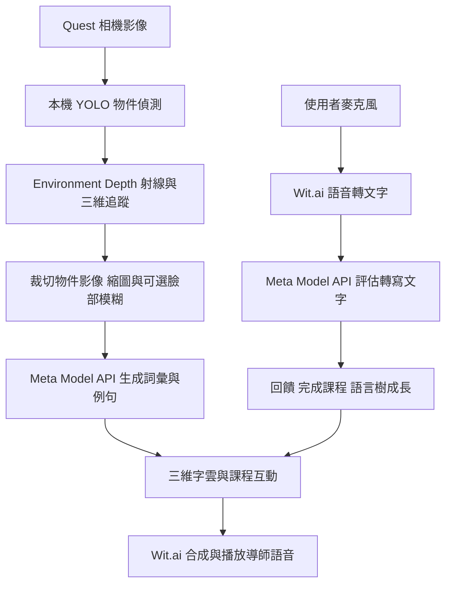

# Spatial Lingo 架構解析與拓展開發

Spatial Lingo 是 Meta 的 Quest 混合實境語言練習開源專案，適合作為「看見生活物品、學習外語、開口描述」的開發底座。建議第一個拓展版本聚焦繁中引導學英文，先打通模型服務、語音服務與學習紀錄，再擴展更多目標語言。

解析日期：2026 年 10 月 23 日。程式基準為上游 `main` 的 `26d8f7cae7f471bc935480f0e4925338d6069088`，提交日期為 2026 年 10 月 12 日，版本為 2.0.0。

## 專案來源與版本

- [上游 oculus-samples/Unity-SpatialLingo](https://github.com/oculus-samples/Unity-SpatialLingo)
- [開發用 fork ENL1217/Unity-SpatialLingo](https://github.com/ENL1217/Unity-SpatialLingo)
- [Meta 官方介紹](https://developers.meta.com/vr/blog/spatial-lingo-open-source-app-ai-assisted-language-practice/)
- [專案 README](../README.md)

這是 Spatial Lingo，不是 Duolingo 官方程式。官方早期文章介紹的是 Llama API；目前下載的 2.0.0 原始碼已改成 **Meta Model API**，預設請求的模型識別碼是 `muse-spark-1.3`。這個值是程式預設值，實際可用模型仍由使用者的 API key 權限決定。

## 執行環境

| 項目 | 原始碼中的設定 | 開發意義 |
| --- | --- | --- |
| Unity | 上游 ProjectVersion 指定 6000.0.62f1；README 最低 6000.0.51f1 | 本 fork 採本機新版 6000.3.27f1，不降版；匯入與相容性修正另開變更 |
| Meta XR SDK | Core、Interaction、Voice、MRUK 等為 81.0.0 | 先保留這組相依版本 |
| 本機推論 | com.unity.ai.inference 2.2.1 | 執行 YOLO 與臉部偵測模型 |
| XR | OpenXR 1.16.0、Meta OpenXR 2.3.0 | Quest 裝置整合 |
| 渲染 | URP 17.0.4 | 3D 字雲、角色、遮擋與特效 |
| Android | IL2CPP、ARM64，專案 min/target SDK 均為 32 | 這是目前專案值，並非商店上架要求的判定 |
| 初始場景 | Assets/SpatialLingo/Scenes/MainScene.unity | 完整體驗入口 |
| 建置設定 | Assets/Settings/BuildProfiles/SpatialLingo-Dev.asset | Android 開發版本 |

依據：[ProjectVersion](../ProjectSettings/ProjectVersion.txt)、[manifest](../Packages/manifest.json)、[Player Settings](../ProjectSettings/ProjectSettings.asset)、[建置說明](BuildInstructions.md)。

本 fork 的開發基準採本機已安裝的 **Unity 6000.3.27f1**，不降回 6000.0。上游 ProjectVersion 尚保留原值；新版匯入、套件與 API 相容性修正需要另外驗證，不能將版本文字更新視為完成遷移。目前已完成原始碼解析及資產下載，尚未在 Unity 匯入、編譯或於 Quest 實機驗證；也沒有呼叫付費模型或語音服務。

完整相機體驗需要支援 Passthrough Camera API 的裝置與系統版本。Android manifest 雖列出 Quest 2、Pro、3、3S，仍不能僅憑這個清單判定相機功能可在所有機型運作。首次實機驗收優先使用 Quest 3／3S，並核對 [Meta 相機 API 文件](https://developers.meta.com/horizon/documentation/unity/unity-pca-overview/)。

## 從相機到口說回饋

物件分類先在裝置端執行，使用 80 個 COCO 類別；主程式排除了 `person` 和 `remote`，避免使用者身體與控制器成為課程。模型可以根據物件裁切圖修正類別名稱，並產生名詞、三個形容詞與兩個動詞。課程取得流程再生成例句，並不是把整段相機串流持續交給雲端。

影像處理以約 400 × 300 的像素預算縮小裁切圖，編碼為 JPEG data URL。臉部模糊取決於是否提供 FaceDetection 實例，不能假定任何呼叫路徑都必然啟用。

目前口說判定的輸入是 **STT 轉寫文字與目標詞彙**。模型可接受發音相近造成的轉寫差異，但沒有收到原始音訊，因此不能把通關結果視為音素、口音或發音準確度分數。若要做發音評分，需要新增音訊分析流程。

## 模組與修改位置

以下路徑以儲存庫根目錄為準。

| 模組 | 主要程式或資產 | 職責與拓展位置 |
| --- | --- | --- |
| 系統初始化 | [SpatialLingoApp.cs](../Assets/SpatialLingo/Scripts/AppSystems/SpatialLingoApp.cs) | 建立相機、追蹤、AI、課程與互動管理器；目前直接 new MetaModelRestApi |
| 相機擷取 | [WebCamTextureManager.cs](../Packages/com.meta.utilities.cameratracking/Runtime/Scripts/WebCamTextureManager.cs) | Passthrough 影像、相機與權限整合 |
| 物件辨識 | [ImageObjectClassifier.cs](../Packages/com.meta.utilities.objectclassifier/Runtime/Scripts/ImageObjectClassifier.cs) | 本機模型推論與分類結果 |
| 三維追蹤 | [CameraTaxonTracker.cs](../Packages/com.meta.utilities.taxontracking/Runtime/Scripts/CameraTaxonTracker.cs) | 結合辨識與深度資料，更新物件空間位置 |
| 模型傳輸 | [MetaModelRestApi.cs](../Packages/com.meta.utilities.metamodelapi/Runtime/Scripts/MetaModelRestApi.cs) | HTTP、認證、模型、文字與視覺請求、用量、服務健康度 |
| 教學 AI | [AssistantAI.cs](../Assets/SpatialLingo/Scripts/AI/AssistantAI.cs) | 教材 prompt、翻譯、例句、對話與口說判定的 JSON 解析 |
| 課程取得 | [LessonsManager.cs](../Assets/SpatialLingo/Scripts/Lessons/LessonsManager.cs) | 挑選物件、併發請求、重試、快取於本次執行、追蹤失去後保留課程 |
| 練習與通關 | [ExerciseManager.cs](../Assets/SpatialLingo/Scripts/Lessons/ExerciseManager.cs) | 聽取轉寫、送出判定、回饋、階段進度與語言樹 |
| 三維教材 | [Lesson3DInteractor.cs](../Assets/SpatialLingo/Scripts/Lessons/Lesson3DInteractor.cs) | 單字與翻譯呈現、名詞／形容詞／動詞組合互動 |
| 主流程 | [AppFlow.asset](../Assets/SpatialLingo/Data/StateGraph/AppFlow.asset) 與 Scripts/States | Unity Visual Scripting 狀態機與 C# 狀態類別；功能擴展可能需要同時修改兩者 |
| 語音 | [VoiceTranscriber.cs](../Packages/com.meta.utilities.speechandtext/Runtime/Scripts/VoiceTranscriber.cs)、[VoiceSpeaker.cs](../Packages/com.meta.utilities.speechandtext/Runtime/Scripts/VoiceSpeaker.cs) | Wit.ai STT、TTS 與播放事件 |
| 語言與紀錄 | [AppSessionData.cs](../Assets/SpatialLingo/Scripts/AppSystems/AppSessionData.cs)、[Language.cs](../Assets/SpatialLingo/Scripts/Language/Language.cs) | 語言映射、目前階段與完成物件；現有 session 資料保存在 static 記憶體 |
| 導師與台詞 | [GollyGoshInteractionManager.cs](../Assets/SpatialLingo/Scripts/Characters/GollyGoshInteractionManager.cs)、[Tutorial.cs](../Assets/SpatialLingo/Scripts/Lessons/Tutorial.cs) | 導師語音、動作、教學台詞；許多引導台詞直接寫在程式內 |

## 語言支援的實際範圍

AssistantAI 列舉了英文、西班牙文、越南文、法文、德文、阿拉伯文、義大利文、泰文、印地文、葡萄牙文、印尼文與他加祿文，共 12 種。然而 AppSessionData、WitaiSettingsHolder、語言選單及映射只接了英文和西班牙文。繁體中文與日文都需要新增完整支援。

新增繁中時需一起處理：

1. 將母語、學習語言、介面語言分開設定。現有 Reset 會將母語與目標語言都重設為英文，主流程選單只選學習語言。
2. 統一語言資料，更新 AI 列舉、名稱、session、語音設定及選單；保留既有 enum 數值，避免破壞 Unity 序列化資產。
3. 導入繁中 UI 與教學台詞，補上支援中文字形的字型及 TMP fallback。
4. 確認 STT 與 TTS 各自支援的語言，不以「模型能翻譯」等同「語音能正確讀出」。
5. 移除英文中心的單字假設，例如教材 prompt 限制替代物件名稱只有一個 word；中文詞彙和日文切詞需要不同規則。

現有語音文件說明，非英語 TTS 部分依賴上下文提示改善讀音；VoiceSpeaker 還有靜音語言提示的做法。因此多國語言產品需要重新驗證語音品質，不能只擴充列舉。

依據：[語言選單](../Assets/SpatialLingo/Scripts/SceneObjects/LanguageSelect.cs)、[Wit 設定映射](../Packages/com.meta.utilities.speechandtext/Runtime/Scripts/WitaiSettingsHolder.cs)、[原專案語音文件](../Packages/com.meta.utilities.speechandtext/Documentation~/VoiceSynthesis.md)。

## API key 與服務替換

開發版在 `Assets/SpatialLingo/Resources/ScriptableSettings/SpatialLingoSettings.asset` 設定 `MetaModelApiKey` 和選填的 `MetaModelId`。模型 key 與 Wit.ai 設定是兩套服務設定，單有模型 token 並不代表所有語音功能都已配置完成。原始模型 key 欄位目前為空，本次沒有填入任何金鑰。

`MetaModelRestApi.GetApiKeyAsync` 可回傳 `(apiKey, endpointOverride)`，因此已有替換 base URL 的入口；預設 URL 為 `https://api.meta.ai/v1/`。文字與影像 DTO 使用 chat completions 形狀，包括 `max_completion_tokens`、`reasoning_effort` 與 `image_url`。其他供應商需要逐項核對請求、錯誤、回應與視覺能力，換網址不等於相容。

建議保留 Meta 實作，再引入小範圍模型介面，讓 AssistantAI 只依賴教學所需的文字、視覺、用量與錯誤結果。新的供應商 adapter 負責轉換欄位，避免教學 prompt 和 HTTP 細節一起變動。語音另設轉寫與合成介面，讓兩者可以獨立替換。

開發 key 可暫留本機設定；多人使用版本建議由後端保存供應商 key，Quest 使用應用程式登入憑證呼叫代理服務。現有 hook 只是客戶端取得憑證與端點的入口，本身不會自動提供安全的後端認證或憑證更新。

**設定檔已被 Git 追蹤。** 雖然 .gitignore 列出了 SpatialLingoSettings.asset，仍不會停止追蹤既有檔案。後續應先完成本機設定分離與敏感值檢查，再寫入個人 key；不能依賴這條 ignore 規則防止提交。

## 開發階段與驗收

### 本機服務與費用目標

後續以本機運算為主，預設不呼叫付費雲端服務。這裡的本機方案是 **Quest 3 執行畫面、手部互動和物件追蹤，Windows PC 經區域網路提供模型與語音服務**。模型下載完成後可不依賴雲端推論；PC 仍須開機，並有硬體與電力成本。所有模型都直接放進 Quest、完全不連 PC，是另外一項裝置端推論工程。

本機已確認有 RTX 4070 12GB、64GB RAM、Ollama，以及 qwen2.5vl:7b 和 llama3.2-vision:latest。可先使用現有 qwen2.5vl:7b 驗證教材生成與看圖；視覺、JSON 契約及互動延遲仍需實測。Quest 呼叫 PC 時不能使用 Quest 自己的 localhost，需透過受控的區網服務端點或 USB 轉送。

以專案杯子範例圖進行兩次本機短測：首次請求在 90 秒逾時；後續請求約 16.24 秒完成，回傳「茶杯」的 JSON。後者仍未遵守指定的英文形容詞和欄位內容要求，因此只能證明本機視覺推論可回應，尚未通過教材契約或即時互動驗收。接入時需要輸出驗證、快取與延遲優化。

| 功能 | 本機改造方向 | 與原版差異 |
| --- | --- | --- |
| 物件偵測 | 保留 Quest 端 YOLO | 已是本機執行 |
| 物件描述與教材 | PC 上的 Ollama 視覺語言模型 | 取代 Meta Model API，需轉換請求與驗證回應 |
| 口說文字判定 | 本機文字模型或同一視覺語言模型 | 仍評估轉寫內容；不等於音訊發音評分 |
| 語音辨識 | PC 的 faster-whisper 等本機 STT | 取代 Wit.ai 轉寫；需串接收音與完成事件 |
| 語音合成 | 本機 TTS，依語言挑選語音 | 取代 Wit.ai 合成；先驗證英文與繁中品質 |

延遲與資源配置可先用 YOLO 類別和詞彙庫生成基本教材，僅在需要更精確物件描述時呼叫視覺模型；教材、固定台詞和音訊可快取。這能減少推論次數，但會犧牲部分依影像細節產生內容的能力。STT 和 TTS 的模型、語音及授權需在選型時逐項確認。

OpenCode 可以作為開發程式的 agent；它不會讓背後的模型自動免費，也不是本 app 必需的推論層。[OpenCode 支援本機模型服務](https://opencode.ai/v2/docs/models)，而 [一般推論 API](https://opencode.ai/v2/docs/console/api/inference) 也提供部分免費 chat 模型。免費端點是否具備視覺能力、限制與持續可用性需依當時服務確認，不能當作永久、無限的預算承諾。OpenCode Go 另有 [以 coding agent 流量為主的使用要求](https://opencode.ai/v2/docs/console/go/)，不應直接將 coding 方案視為語言學習 app 的通用後端。

免費雲端服務僅列為使用者選用的後備來源；任何失敗都不應自動轉向付費供應商。目前原 app 尚未接上上述本機服務。

### 免編譯安裝的確認結果

2026 年 10 月 23 日查詢上游 GitHub，Releases 為空；Actions 可見的兩個 artifacts 是 SARIF 程式掃描報告，沒有 APK。[官方商店頁](https://www.meta.com/experiences/spatial-lingo-language-practice/24846121391731831/) 存在，但已連線的 Quest 3 實際顯示「你所在的地區無法使用此應用程式」。本次未能安裝。

商店版的實際版本與是否使用官方託管服務，也不能只依 GitHub 的 2.0.0 推定。若要安裝自訂本機 AI 版本，仍須先完成程式整合，再產出一次 APK；之後的 PC 模型與教材服務更新可依介面相容程度獨立進行。

| 階段 | 工作 | 驗收條件 |
| --- | --- | --- |
| 0 新版執行基礎 | 使用 Unity 6000.3.27f1 匯入，保留 Quest 場景並修正套件與 API 相容性；接本機服務 | 編譯成功；Quest 可授權相機／麥克風、辨識物件、顯示字雲、播放語音並完成一次練習 |
| 1 繁中學英文 | 繁中介面與引導、英文目標語、語言資料整合、字型、模型與語音介面、本機 key 分離 | 同一物件顯示繁中解釋及英文教材；英文口說可通關；錯誤理由可用繁中呈現；無中文字缺字 |
| 2 學習紀錄 | 本機持久化、已學詞彙、練習次數、最近學習時間與複習安排 | 關閉重開後保留進度；換語言不混用紀錄；可清除或匯出個人紀錄 |
| 3 多語與新情境 | 新目標語、餐廳／旅遊／工作情境、跨物件造句、角色對話 | 每一新增語言分別驗證教材、字型、STT、TTS 和回饋；情境任務有明確完成條件 |

第一個可展示的拓展版本建議停在階段 1，並加入最小的學習紀錄。這樣可以先驗證台灣使用者在自己的房間以繁中引導練英文的完整體驗。

### 實作時優先保留的行為

LessonsManager 已有初期併發取得課程、退避與重試、等待玩家答題時暫停取得、以及依視野與距離排序等機制。不要為了接新模型整個重寫；先保留課程資料與排程，只替換服務介面。

模型層已有 token 用量、往返耗時、finish reason 與連續失敗追蹤。後續成本控制可沿用這些指標，加上每次 session 的請求與 token 預算，並將課程快取依語言與教材版本保存。口說判定已區分「未收到可用判定」和「答錯」，替換 adapter 時應保留這個差異。

### 需要新增的有效測試

- 模型契約：空回應、格式錯誤、截斷 JSON、超時、401、429，以及影像不支援時的行為。
- 語言映射：每個選項都能解析到對應教材、字型與語音設定，不默默回落成英文。
- 口說判定：沒有服務回覆不能扣玩家答題次數；過期回覆不能完成已切換的課程。
- 持久化：重開還原、資料版本升級、損壞資料復原及不同語言的進度隔離。
- 實機流程：權限拒絕、網路中斷、重複辨識同一物件、空間追蹤失去與恢復。

## 專案管理

本機 `origin` 指向自己的 fork，`upstream` 指向 Meta 原始專案。保留 `main` 作為上游基準，拓展功能另開分支；本次解析文件放在 `codex/project-analysis`。

根目錄 LICENSE 為 MIT。專案另外包含字型 EULA 和各套件授權檔，正式發佈前應按實際使用資產整理授權與署名清單。

本次工作只新增解析文件，沒有更改執行程式、Unity 相依版本、場景、模型或語音設定。
